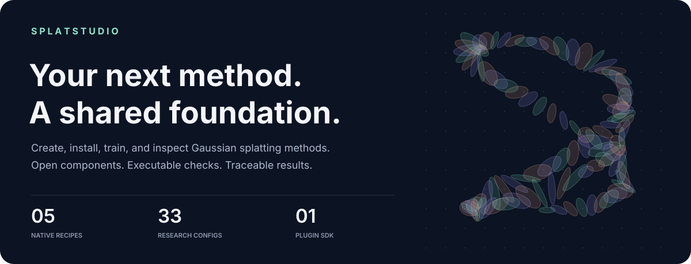
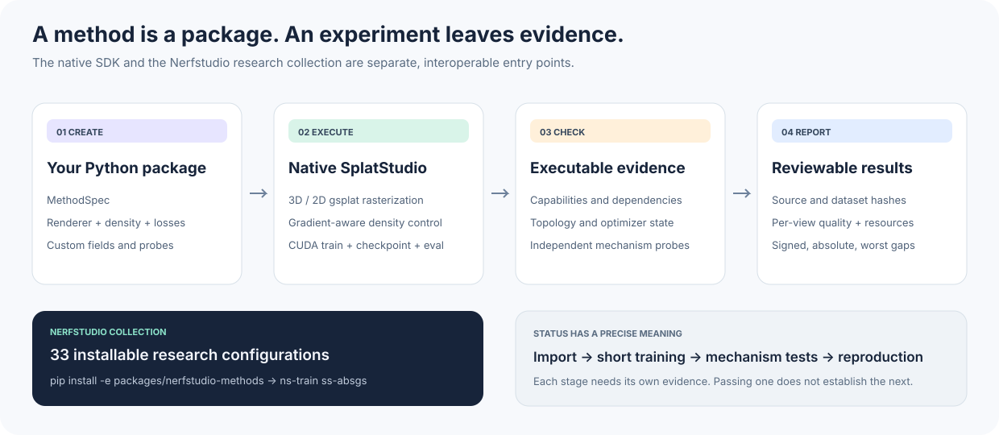

<p align="center">
  
</p>

<p align="center">
  <a href="https://github.com/seemandhar/splatstudio/actions/workflows/ci.yml"></a>
  <a href="LICENSE"></a>
  <a href="docs/methods.md"></a>
  <a href="docs/results.md"></a>
</p>

<p align="center">
  <a href="docs/installation.md"><b>Install</b></a> ·
  <a href="docs/methods.md"><b>Method collection</b></a> ·
  <a href="docs/custom-methods.md"><b>Build a method</b></a> ·
  <a href="docs/results.md"><b>Results &amp; validation</b></a> ·
  <a href="docs/roadmap.md"><b>Roadmap</b></a>
</p>

**SplatStudio is an open research toolkit for Gaussian splatting.** Package a method in its own repository, install it with `pip`, and run it through a shared training and evaluation workflow. Replace the rasterizer, density controller, or objective through explicit interfaces, then attach executable checks to the mechanisms you want others to trust.

The repository includes a **native gsplat runtime with five configurations**, a **33-configuration Nerfstudio collection imported from SPLATIFY**, an external plugin example, and downloadable evaluation records. These are experimental implementations. Configuration variants are counted separately; **33 configurations does not mean 33 independently reproduced papers**. The [method cards](docs/methods.md) distinguish imported code, short training checks, prerequisites, and known approximations.

## Start training

Install a CUDA-compatible [PyTorch](https://pytorch.org/get-started/locally/) first, using Python 3.10 or newer. gsplat may compile its CUDA extension on first use; the compiler toolkit must match your PyTorch setup. See [tested environments](docs/installation.md).

```bash
git clone https://github.com/seemandhar/splatstudio.git
cd splatstudio
pip install -e '.[runtime]'

ss-methods
ss-verify gsplat --device cuda

# Generate a tiny scene with an independent NumPy sphere ray caster.
splatstudio demo-data --output data/spheres
ss-train gsplat --data data/spheres --output runs/my-first-splat \
  --steps 700 --num-gaussians 192
ss-eval --run runs/my-first-splat --split test --save-images
```

The synthetic scene is a quick installation and training check. For a real scene, supply a Nerfstudio `transforms.json` dataset. Distorted cameras can be converted explicitly:

```bash
pip install -e '.[data]'
splatstudio prepare-data --data /path/to/scene --output data/scene-pinhole --downscale 4
ss-train gsplat --data data/scene-pinhole --output runs/scene
ss-eval --run runs/scene --save-images
```

## Choose a method

| Native configuration | What it runs |
| :--- | :--- |
| `gsplat` | 3D rasterization, SH appearance, standard adaptive density control |
| `gsplat-absgrad` | Absolute screen gradients with a matching density controller |
| `gsplat-aa` | gsplat's 2D antialiasing compensation; incomplete Mip-Splatting |
| `gsplat-mcmc` | gsplat's MCMC relocation, sampling, and noise strategy |
| `gsplat-surfel` | Actual 2D rasterization, normals, and scheduled gsplat L1 distortion |

All five use `ss-train METHOD`. The 2D recipe uses different primitives and an L1 distortion objective; it is not an exact reproduction of the original 2DGS recipe. Its geometry regularization starts after the short release checks. See [results and limitations](docs/results.md).

The Nerfstudio collection includes **AbsGS, BOGausS, Micro-Splatting, Opti3DGS, Decomposing Densification, LightGaussian, Pixel-GS, Scaffold-GS, CoR-GS, DWTGS, FSGS, FastGS, CompGS, Trick-GS, RAIN-GS**, and additional configurations. Install it into a Nerfstudio environment:

```bash
pip install -e packages/nerfstudio-methods
ns-train ss-absgs --data /path/to/scene
ns-train ss-opti3dgs --data /path/to/scene
```

These entries use Nerfstudio's trainer and viewer. They are not yet native `MethodSpec` plugins. Browse the [complete catalog](docs/methods.md) for all commands, source files, paper links, test status, and auxiliary data requirements. From the native CLI, `ss-methods --catalog` returns the same machine-readable catalog.

## Bring your own method

```bash
ss-create my-method --output ../my-method
pip install -e ../my-method
ss-inspect my-method
ss-verify my-method --device cuda
ss-train my-method --data data/scene-pinhole --output runs/my-method
```

Your package registers an ordinary Python entry point:

```toml
[project.entry-points."splatstudio.methods"]
my-method = "ss_my_method:method"
```

The generated scaffold starts from the baseline. Add components and mechanism checks to implement your contribution. The [scale-prior example](examples/scale_prior) demonstrates an independently installed loss, an analytic gradient check, and an extra Gaussian field that survives topology changes. See the [authoring tutorial](docs/custom-methods.md) and [interface reference](docs/interfaces.md).

## How it fits together



SplatStudio checks component requirements before training and compares declarations with the instantiated renderer and density controller. Runtime checks catch stale optimizer references, mismatched Gaussian fields, and nonfinite states. Source hashes, dataset hashes, splits, per-view metrics, memory, and Gaussian counts travel with each native run.

Verification has a deliberately narrow meaning: passed probes establish the checks they execute. They do not certify a complete paper. CPU-only verification records CUDA checks as unverified, and returns exit code 2. Static checking is labeled separately.

## Results you can inspect


The [results report](docs/results.md) includes fresh CUDA runs on an analytic fixture and the real Nerfstudio Poster scene, with per-view scores, training traces, source manifests, resource measurements, and fixed commands. Every native configuration is shown, including weak results. These are short runtime checks on one real scene and one synthetic fixture, **not a paper benchmark or a claim of comparative superiority**.

We also release [58 historical scene evaluations](results/historical/metrics.csv) covering 10 catalog configurations. Their original training recipes and checkpoints have not been verified, so they are explicitly separated from fresh runs and excluded from paired comparisons.

```bash
ss-compare reference.json candidate.json --output comparison.json
```

Comparisons require matching scenes, seeds, splits, metric coverage, and evaluation protocols. Reports include signed, absolute, and worst-case gaps, per-pair decisions, and resource ratios. Training budgets remain an explicit experimental choice.

## Contribute

```bash
pip install -e '.[runtime,data,dev]'
pytest -q
ruff check src tests examples scripts
python scripts/check_repository.py
```

Start with [CONTRIBUTING.md](CONTRIBUTING.md). High-priority work includes independent contribution tests, native migration of research ports, original-author comparisons, controlled composition, and renderer extensions. The [roadmap](docs/roadmap.md) separates implemented infrastructure from open research questions.

## Credits and citation

SplatStudio builds on [gsplat](https://github.com/nerfstudio-project/gsplat) and [Nerfstudio](https://github.com/nerfstudio-project/nerfstudio). The method collection originates in [SPLATIFY](https://github.com/seemandhar/splatify); its exact source commit and file hashes are preserved in [ORIGIN.json](packages/nerfstudio-methods/ORIGIN.json). Please cite the original method papers when using their techniques.

```bibtex
@software{jain2026splatstudio,
  author = {Jain, Seemandhar and Gupta, Keshav and Chandraker, Manmohan},
  title = {SplatStudio: Installable Methods and Traceable Experiments for Gaussian Splatting},
  year = {2026},
  url = {https://github.com/seemandhar/splatstudio}
}
```

Released under the [MIT license](LICENSE). Dependencies and original third-party implementations retain their own licenses. Machine-readable software citation: [CITATION.cff](CITATION.cff).
