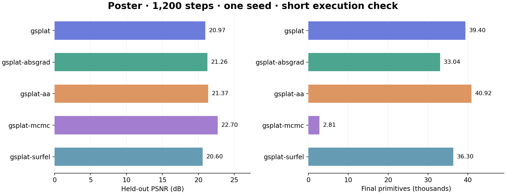
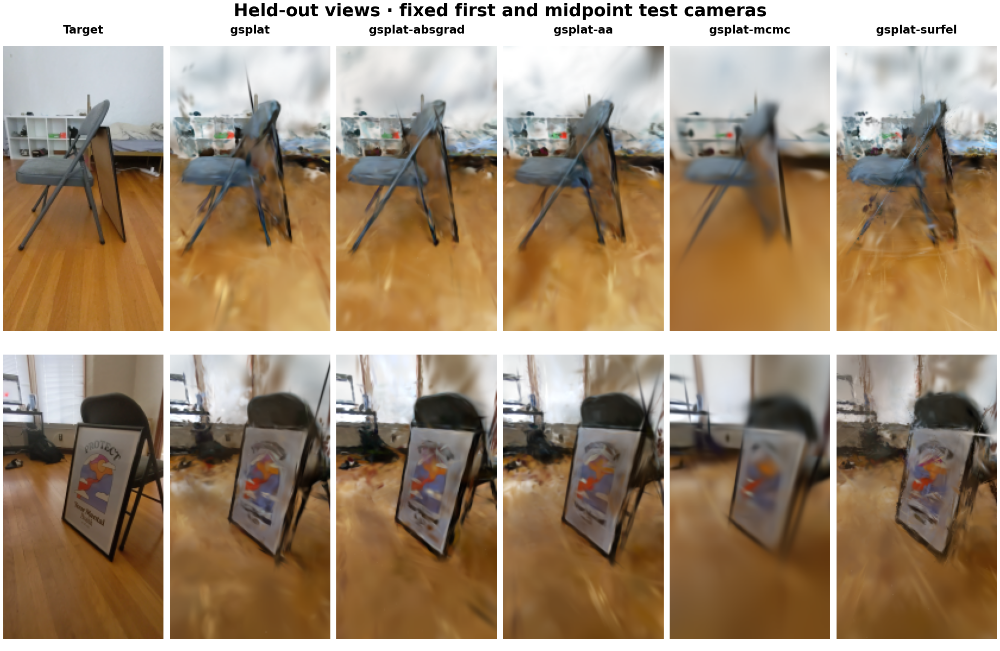

# Results and validation

This release publishes **29/33 short Nerfstudio training checks**, all 33 configuration imports, six native fixture runs (including the external scale-prior plugin), and five native runs on the real Poster scene. These establish installation and limited execution coverage. **No complete paper reproduction is certified by this release.**

## Fresh native runs

The real scene is [Nerfstudio's Poster capture](https://docs.nerf.studio/quickstart/custom_dataset.html). OpenCV undistortion with alpha=0 and 8× downscaling produces 135×240 RGB images. The deterministic partition has 169 train, 28 validation, and 29 test images. All five configurations use seed 0, 2,000 initial SfM points, 1,200 training steps, a 100,000-primitive stop limit, and the same training/evaluation protocol. Test images do not participate in optimization. This short recipe is fixed across configurations but **does not fix final primitive counts**.

| Native configuration | Test PSNR ↑ | Test SSIM ↑ | Final primitives | Peak allocated memory, MiB | Train seconds |
| :--- | ---: | ---: | ---: | ---: | ---: |
| `gsplat` | 20.973 | 0.7279 | 39,395 | 65.0 | 5.7 |
| `gsplat-absgrad` | 21.260 | 0.7340 | 33,040 | 58.2 | 5.5 |
| `gsplat-aa` | 21.365 | 0.7347 | 40,921 | 66.7 | 5.6 |
| `gsplat-mcmc` | 22.701 | 0.7514 | 2,811 | 18.6 | 5.4 |
| `gsplat-surfel` | 20.598 | 0.6834 | 36,303 | 71.1 | 9.4 |





The qualitative grid uses the first and midpoint held-out cameras, selected by index. Metrics average per-view values, not selected images. This is one seed on one real scene, with short schedules, no uncertainty estimate, and different final populations. Training times were measured on a shared multi-GPU host; they are not controlled throughput comparisons. Numbers must not be presented as a paper leaderboard or method superiority claim. The 2D recipe uses the actual 2D rasterizer, while its normal/distortion warmups occur after these runs. Neither geometry reconstruction quality nor the late loss schedule is established here.

The sphere fixture is independently ray-cast by NumPy: 16 images at 32×32, with 8 train/4 validation/4 test views. Each native recipe and the external plugin runs 700 steps from 192 points, crossing the standard density-control start. It is a software fixture with simple geometry and initialization from its known surfaces.

| Fixture configuration | Test PSNR | Test SSIM | Final primitives |
| :--- | ---: | ---: | ---: |
| `gsplat` | 19.307 | 0.7490 | 622 |
| `gsplat-absgrad` | 19.516 | 0.7661 | 580 |
| `gsplat-aa` | 20.832 | 0.7960 | 713 |
| `gsplat-mcmc` | 20.727 | 0.8080 | 211 |
| `gsplat-surfel` | 19.245 | 0.7381 | 479 |
| `scale-prior` | 19.437 | 0.7544 | 623 |

[Portable native records](../results/native) contain per-view metrics, exact specifications, initialization and data hashes, source manifests, dependency versions, GPU, training traces, and verification reports. [CSV export](../results/native/metrics.csv). Local filesystem paths are replaced with dataset descriptors. Checkpoints and source datasets are regenerated by the commands below and are not committed.

```bash
# Native environment; see installation.md for CUDA setup.
pip install -e '.[runtime,data]'
pip install -e examples/scale_prior
splatstudio demo-data --output artifacts/release-spheres --size 32
python scripts/run_native_suite.py --data artifacts/release-spheres \
  --output artifacts/release-native --steps 700 --num-gaussians 192 \
  --methods gsplat gsplat-absgrad gsplat-aa gsplat-mcmc gsplat-surfel scale-prior

# Obtain the Poster dataset in a Nerfstudio environment:
# ns-download-data nerfstudio --capture-name poster
splatstudio prepare-data --data /path/to/poster \
  --output artifacts/poster-undistorted --downscale 8
python scripts/run_native_suite.py --data artifacts/poster-undistorted \
  --output artifacts/release-poster --steps 1200 --num-gaussians 2000
```

## Collection audit

All 33 entries import against **stock Nerfstudio 1.1.5**. Twenty-nine pass ten training steps with real forward/backward, optimizer updates, callbacks, finite-state checks, and checkpoint writing. DepthRegGS, FSGS, StableGS, and FeatureGS are not run because the fixture does not supply their teacher weights/feature targets. Their absence is not counted as success.

The audit found and fixed CoR-GS initialization before Nerfstudio's device property exists, uint8 ground-truth handling in CoR-GS/Scaffold-GS, and two shadowed normal-loss functions affecting the legacy 2DGS port. [Final audit](../results/validation/zoo.json) includes every result and source hashes. [Development findings](../results/validation/development-findings.json) retain earlier failures and the preliminary native 2D regularization issue. The audit leaves late densification, sparsity schedules, compression exports, geometry accuracy, and original-author fidelity untested.

```bash
# In the native environment, convert the analytic fixture for Nerfstudio:
python scripts/prepare_zoo_fixture.py --source artifacts/release-spheres \
  --output artifacts/zoo-spheres
# Then activate the Nerfstudio collection environment.
python scripts/validate_zoo.py --data artifacts/zoo-spheres \
  --output artifacts/zoo-release --steps 10 --gpus 0
```

## Historical results

The [historical JSON](../results/historical/records.json) and [CSV](../results/historical/metrics.csv) preserve 58 existing scene evaluations across 10 catalog configurations. They include PSNR/SSIM/LPIPS values as recorded by earlier SPLATIFY experiments, plus hashes of the source records. Source exports include per-image dispersion; this is not uncertainty across training seeds.

Original checkpoints, commits, seed values, split definitions, and resource budgets were not recovered. These exports are labeled `historical_unverified`, are not fresh SplatStudio results, and cannot be used as matched reference measurements. Missing results for other methods are left missing.

## What a reproduction comparison needs

Run original-author code and the candidate with an identical dataset, split, metric implementation, and documented training/resource budget. Match scenes and seeds, then use `ss-compare`. The report gives mean signed, mean absolute, and worst absolute gaps, all per-pair gaps, and resource ratios. Equal scene weighting prevents repeated seeds from giving a scene extra influence.

Source and protocol hashes detect changes; they do not prove the underlying method. PSNR tolerance alone cannot distinguish a faithful implementation from a strong baseline. Independent tests for the paper's actual mechanisms, repeated seeds, held-out scene selection, and relevant baselines remain required. See [the research roadmap](roadmap.md).
